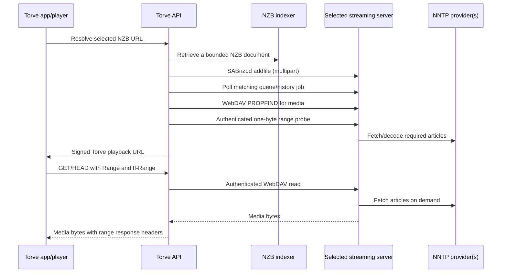

# Usenet streaming backends

Torve can use NZBDav, InfiniDysk, NzbDavEx, AltMount and Decypharr through
one SABnzbd/WebDAV adapter. Select a server under **Settings → Integrations
→ Usenet streaming**. One server is active per Torve account; that server can
use multiple NNTP provider accounts, priorities and failover.

NNTP credentials are configured in the streaming server. Torve stores its API
key and WebDAV connection credentials encrypted. It does not need a separate
integration for every Usenet reseller or backbone.

## Recommendation and current alternatives

Research checked on 28 October 2026:

| Project | Maintenance evidence | Fit for Torve |
| --- | --- | --- |
| [InfiniDysk](https://github.com/infinidysk/infinidysk) | Maintained NZBDav successor; stable [v1.6.3](https://github.com/infinidysk/infinidysk/releases/tag/v1.6.3) published 21 October 2026 | Recommended first trial. Continues the SABnzbd/WebDAV model and maintains its NNTP, decoding and archive dependencies. |
| [AltMount](https://github.com/kipsilabs/altmount) | Independent Go implementation; [releases](https://github.com/kipsilabs/altmount/releases) include an October maintenance release for its older storage format | Good independent alternative, especially when built-in filesystem mounting is also useful. Enable its SABnzbd API explicitly. |
| [Decypharr](https://github.com/sirrobot01/decypharr) | Maintained media gateway; [v2.7.1](https://github.com/sirrobot01/decypharr/releases/tag/v2.7.1) published 22 October 2026 | Useful for a combined debrid and direct NNTP installation. Debrid is optional for its Usenet path. |
| [NzbDavEx](https://github.com/qooode/nzbdavex) | Extended fork; stable v1.2.0 from June 2026 and latest observed commit 23 June | Compatible option with lower recent activity than InfiniDysk. Do not assume an equally active maintenance cadence. |
| [Original NZBDav](https://github.com/nzbdav-dev/nzbdav) | README explicitly says it is no longer maintained | Supported for existing installations; use a maintained successor for a new deployment. |

These projects publish MIT-licensed software. Free software does not supply
free Usenet service, indexer access, hosting or bandwidth. Conventional
SABnzbd/NZBGet installations download and repair complete releases; they do
not supply the virtual WebDAV streaming behavior expected here.

InfiniDysk describes an upgrade from original NZBDav v0.6.4 in its
[migration guide](https://www.infinidysk.com/getting-started/migration/).
Its drop-in claim concerns that server and its data, not Torve's old HTTP
adapter. The previous Torve adapter called `/api/health` and `/api/jobs`,
which are not the SABnzbd contract exposed by those servers.

## Provider compatibility and TorBox

A provider must offer access to binary articles over standard NNTP, with a
hostname, supported port, account credentials and preferably TLS. Configure
these in the chosen server; see [InfiniDysk's provider settings](https://www.infinidysk.com/configuration/usenet/)
or [Decypharr's NNTP documentation](https://docs.decypharr.com/guides/usenet/overview/).
An indexer's search/API account is a separate service and does not grant NNTP
article access. Web-only search accounts are not automatically NNTP accounts.

Compatibility is broad rather than a guarantee that every release is
available everywhere. Retention, missing articles, removals, regional servers,
provider connection limits, account sharing policies, quotas and sustained
throughput still apply. A backup on a different backbone can help recover
missing articles. The server owns that policy; Torve should not duplicate it.
Start below the provider's connection limit and reserve capacity for playback.

**TorBox is not required for this direct NNTP path.** It remains an optional
cloud/debrid route. Running a free streaming server replaces that part of the
workflow with your own provider account and server; it does not turn the
underlying services into free ones.

## Data flow

Content is still transferred, decoded and buffered. Complete-file downloads
are not required before playback, but RAM, metadata and optional disk caches
are used. Seeking can fetch a different set of articles. Repeated reads can
consume provider quota again. The server handles RAR/7z and passwords where
supported; the Torve player handles video/audio codecs. No transcoder is added.

Rclone, Sonarr/Radarr, Plex and Jellyfin are unnecessary for this on-demand
Torve route. Media passes through both the streaming server and Torve API;
size network capacity and server egress accordingly. See the
[upstream architecture comparison](https://www.infinidysk.com/guides/compare/).

## Connection settings

Use the **server base URL**, not the URL of its SAB API endpoint. Backend
selection supplies defaults. Advanced overrides support reverse proxies,
separate WebDAV hosts and customized virtual directory layouts.

| Backend | Default API path | Default WebDAV root | Default content path |
| --- | --- | --- | --- |
| NZBDav / InfiniDysk / NzbDavEx | `/api` | Server base URL | `/content/{category}/{name}` |
| AltMount | `/sabnzbd/api` | Base URL + `/webdav` | `/{category}/{name}` |
| Decypharr | `/sabnzbd/api` | Base URL + `/webdav` | `/__all__/{name}` |

For NZBDav-family servers, `{name}` is the basename of the completed history
storage directory. For Decypharr it is the history job name, matching its
default filename-based WebDAV folder naming; its filesystem download path
removes an extension and must not be used indiscriminately. AltMount category
names are mapped to their configured directory through SAB `get_config`.

Available template placeholders are `{name}`, `{storage_name}`, `{category}`
and `{id}` (the upstream job ID). For Decypharr configured with
`filename_no_ext`, use `/__all__/{storage_name}`; for `infohash`, use
`/__all__/{id}`. Custom original-name layouts should be configured to a
deterministic supported naming mode. For a non-default AltMount complete
directory, override the content template to include its virtual path.

WebDAV username/password are separate from the SAB API key. Leave both blank
only for a deliberately unauthenticated private WebDAV server. Passwords and
API keys are never returned in status or playback responses. A backend switch
resets path overrides so defaults for the new backend take effect.

The Torve API must reach both server endpoints and the NZB retrieval URL.
`localhost` on your PC is not `localhost` on a remotely hosted Torve API.
Private hosts are rejected by default. For an isolated self-hosted Torve API
on the same LAN/Docker network, set `NZBDAV_ALLOW_PRIVATE_HOSTS=true` there.
Use authenticated HTTPS for remote endpoints. Do not disable the shared
production API's private-host guard just to reach a personal NAS.

## Minimal proof of concept

1. Start a **fresh** InfiniDysk container using
   [the small Compose example](examples/usenet-streaming.compose.yml). Keep
   its configuration separate from an existing NZBDav installation. Record
   the actual running version/image digest, then pin that digest for repeatable
   tests. This research observed v1.6.3 as the latest stable release.
2. In InfiniDysk, create the administrator account, configure one NNTP provider
   with TLS and conservative connection limits, and configure WebDAV credentials.
   Note the SAB API key. Leave optional automation, prewarming and caches at
   their defaults for this first test.
3. Verify one known-good NZB for content you may access directly in InfiniDysk.
   Prefer a small, single-video release initially. Get its NZB retrieval URL
   from your indexer; a Torve `hash_key` alone cannot retrieve an NZB.
4. Apply Torve backend migration **0040** before running the new application
   code. Keep `INTEGRATION_SECRET_KEY` stable. Configure **Usenet streaming**
   with backend **InfiniDysk**, the reachable server URL, its API key and the
   WebDAV username/password. Test, then save. Existing API route names stay
   `/integrations/nzbdav/*` and `/resolver/usenet/*` for client compatibility.
5. Select that NZB through Torve's Usenet source/browse flow. Check preparation
   reaches Ready, playback starts, and forward/backward seeks work. Disable or
   remove TorBox for this isolated test to establish that the direct path is
   being used. Account/device authorization still applies.
6. Repeat with another backend using a separate configuration. For AltMount,
   enable SAB compatibility and check category mappings. For Decypharr, configure
   NNTP, its API token and WebDAV authentication independently of debrid.

Acceptance checks:

- Queue API authentication and WebDAV authentication must both pass. A public
  version endpoint or HTML sign-in page must not count as success.
- NZB submission returns a real `nzo_id`; polling selects that job, not another
  user's newest history item. Mounted media passes an authenticated one-byte
  `206 Content-Range` probe before Torve reports Ready.
- Forward `Range` and `If-Range`; preserve `206`, `Content-Range`, `Content-Length`,
  `Accept-Ranges`, ETag and Last-Modified when present. Verify HEAD requests.
- Seek after 15 minutes and reconnect within the six-hour playback session.
  Preparation-cache eviction must not invalidate an active session. Changing,
  disabling or deleting the server configuration must revoke its playback URLs.
- Test wrong API key, wrong WebDAV password, unreachable server, missing articles,
  rate limiting and a failed extraction. Failure messages must remain normalized.
- Use two accounts/backends with the same release identifier. Cached availability
  and dead-release results must not cross account/configuration boundaries.
- Try a multipart archive and, separately, a two-video pack. The adapter excludes
  sample files and rejects ambiguous multiple-video releases rather than choosing
  an arbitrary episode. Selecting individual files from packs is future work.
- Confirm no API key, WebDAV credential or signed indexer query value appears in
  playback URLs or application logs.

## Operational and validation limits

Automated tests exercise each backend's documented HTTP contract with controlled
responses, including multipart submission, path differences and range probing.
Additional PostgreSQL/API tests cover encrypted settings, warm-to-resolve-to-play
flow, range proxy authentication and revocation. These do not certify a paid
NNTP account's retention, speed or real-world playback. Run the above live checks
before treating a provider/backend combination as production-verified.

Playback and preparation caches remain in-process. A restart invalidates their
URLs, and multiple API workers need consistent routing or a future shared cache.
Six hours is the default playback URL lifetime, configurable with
`NZBDAV_HANDOFF_TTL_SECONDS`. Single-video releases are supported; automatic
episode selection from multi-video packs is intentionally not inferred.

For rollback, stop the new Torve backend, roll back its code and downgrade the
new schema revision only if you intend to discard its encrypted connection
profiles. The original API-key column and account configuration remain intact.
Never attach a new streaming-server image to your sole existing configuration
volume without following that project's backup/migration instructions.

## Implementation verification: 28 October 2026

- Fresh PostgreSQL 16 database: migrations 0001–0040 applied successfully;
  downgrade 0040→0039 and re-upgrade also passed.
- 81 focused backend tests passed together, including existing config, warm,
  resolve, proxy, authorization, failure and acceleration-emission coverage.
  After adding three protocol cases and extending proxy error checks, all 29
  new connection/protocol cases passed; unchanged existing results were reused.
  The final sample-file filtering adjustment was followed by a fresh pass of
  all 23 protocol cases. This covers 84 distinct backend tests.
- 100 shared Usenet/settings tests passed, including every backend's serialized
  configuration, credential redaction and shared setup-view-model behavior.
- Desktop and Google Mobile Kotlin compilation passed. The Android check
  excluded `processGoogleMobileDebugGoogleServices` because the public checkout
  intentionally has no private `google-services.json`; it was a compile check,
  not a signed or deployable app build.
- Both modified Swift files passed grammar parsing. A native Apple build was
  not run: the configured MacinCloud host rejected noninteractive SSH login.
  No paid GitHub Mac job was dispatched. Xcode type checking remains required.
- No real NNTP credentials, provider subscription or running personal streaming
  server was used. Actual provider playback/retention/throughput remains a live
  acceptance check, as described above. Nothing was deployed.
